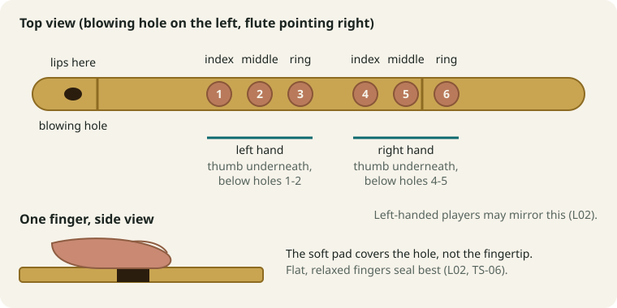

# L02 - Posture and Holding

**Objectives:** BOD-01, BOD-03, BOD-04, BOD-05, BOD-08
**Time span:** Days 1-3 to learn; checked every session afterwards
**Prerequisites:** [L00](L00-day-0-your-flute.md) (holding side chosen)
**Previous:** [L01](L01-how-to-practise.md) | **Next:** [L03 - Breathing Basics](L03-breathing-basics.md)

---

## 1. Learning objectives

- Sit with a tall, relaxed posture, on the floor or on a chair (BOD-01).
- Hold the flute steadily, supported by your thumbs and lip contact (BOD-03).
- Cover the holes with the flat pads of your fingers and seal them with minimal pressure (BOD-04).
- Scan your body for tension and release it while playing (BOD-05).
- Recognise the warning signs of a playing injury and know when to rest or see a doctor or physiotherapist (BOD-08).

## 2. Prerequisites

You have chosen your holding side in [L00](L00-day-0-your-flute.md). This lesson assumes right-pointing (left hand on top). If you hold to the left, swap "left" and "right" throughout.

## 3. Simple explanation

Good posture has two jobs. It **lets you breathe deeply**: a slumped chest cannot fill with air. And it **frees your fingers**: if your hands are busy gripping the flute, they can't move quickly or seal holes accurately. The ideal is a hold that is **stable but light**. The flute rests on a few support points, and the fingers only cover holes.

On a C medium flute (about 48 cm), the holes are moderately spaced. Most adults can reach them with the finger pads without strain. Players with small hands sometimes use the middle segment of the fingers instead of the pads (a "piper's grip") on longer flutes. On your size, try the pad grip first (Recommendation).

## 4. Step-by-step instructions

### Step 1: Sitting posture (BOD-01)

**Floor (traditional):** sit cross-legged on a firm cushion, with your hips slightly higher than your knees. This tilts the pelvis forward so the spine stays upright without effort.

**Chair:** sit near the front edge, feet flat on the floor, knees at about 90 degrees, back not leaning on the backrest.

In both cases:

1. Imagine a thread gently pulling the top of your head upward.
2. Let your shoulders drop and widen. They should not be raised or pulled back stiffly.
3. Keep your chin level, neither tucked nor lifted.
4. Keep your chest open and your belly free to move (no tight belt).

### Step 2: Bring the flute to your lips (BOD-03)

1. Hold the flute horizontally in front of you, the blowing hole facing you and the holes facing up.
2. Turn your head **slightly** toward the left (toward the blowing end). Do not twist your neck strongly; turn the flute to meet you rather than turning yourself to meet the flute.
3. Rest the blowing-hole area against your lower lip, just below its edge, with the blowing hole roughly centred under your lips. [L04](L04-first-sound.md) fine-tunes this.
4. The flute should be roughly parallel to your lips. Many players angle the far end slightly down; a slight downward angle is fine.

### Step 3: Place your hands (BOD-03, BOD-04)

**Top hand (left), holes 1-3:** index finger on hole 1, middle on hole 2, ring on hole 3. Your **left thumb** goes underneath the flute, roughly below the index or middle finger, giving support.

**Bottom hand (right), holes 4-6:** index on hole 4, middle on hole 5, ring on hole 6. Your **right thumb** goes underneath, roughly below the index or middle finger.

**Little fingers** rest lightly on the bamboo or float in the air. They do not press.

**Support points:** the flute is held by **3 points**: the lower lip (or chin area), the left thumb and the right thumb. Fingers covering holes add light pressure from above. If you lifted all six fingers at once (all holes open), the flute should stay steady on the three support points. Test this now.

### Step 4: Finger pads, not fingertips (BOD-04)

The **pad** is the soft, fleshy part between the tip of the finger and the first joint. Use the pad because:

- it is wider than the hole, so it seals reliably;
- fingers lie flatter and more relaxed;
- it is the basis of half-holing later ([L16](L16-shuddha-ma-and-half-holing.md)), where you slide the pad partly off a hole.

**Pressure test:** close all six holes. Press as hard as you can for 2 seconds, then release until the fingers are barely touching. Find the **lightest pressure that still covers the hole completely**. That is your playing pressure. You'll check whether it seals when you play mandra Pa in [L11](L11-lower-notes-ni-dha-pa.md).

**Seeing the seal:** after holding all holes closed for 10 seconds, look at your finger pads. A full ring mark on each pad means the hole was covered. A partial ring means the finger was off-centre.

### Step 5: Tension scan (BOD-05)

Do this at the start of every session and halfway through:

1. **Jaw:** let your teeth part slightly. No clenching.
2. **Lips:** soft, not pressed together hard.
3. **Neck:** the head floats; no strain in the side of the neck.
4. **Shoulders:** let them drop. Raised shoulders are the most common fault.
5. **Elbows:** hang naturally, slightly away from your body. They should not be pinned to your sides or raised like wings.
6. **Wrists:** fairly straight. A strongly bent wrist causes strain.
7. **Fingers:** gently curved or flat; no white knuckles.

### Step 6: Warning signs and when to stop (BOD-08)

Tension that you ignore can become an injury. Repetitive strain (from gripping, bent wrists or long sessions without breaks) can stop you playing for weeks or months, so learn the difference between normal tiredness and a warning sign now, before you play for longer.

| What you notice | What it means | What to do |
|---|---|---|
| Mild muscle tiredness in the hands, lips or shoulders that goes away within an hour of stopping | Normal for a beginner | Keep taking breaks every 15-20 minutes ([L01](L01-how-to-practise.md)); do the tension scan |
| Aching that appears in the same place every session | Usually tension or posture (gripping, bent wrist, raised shoulders) | Shorten sessions, re-check Steps 3-5 on video, use the fixes in [TS-08](../troubleshooting/TS-08-body-pain-and-tension.md). If it is not better within a week, see a professional |
| Sharp pain while playing | Not normal | Stop for the day. Do not play through it |
| Pain that continues after you stop, returns every session, or wakes you at night | A possible strain injury | Stop playing and see a doctor or physiotherapist |
| Numbness, tingling or "pins and needles" in fingers, hands or arms; weakness or clumsiness in a finger | Possible nerve irritation | Stop playing and see a doctor or physiotherapist |
| Jaw pain, clicking or locking that persists; swelling | Possible joint or soft-tissue problem | Stop playing and see a doctor (or a dentist for the jaw) |

**Fact:** this course cannot diagnose injuries, and none of this is medical advice. **Recommendation:** when you are unsure whether something is tiredness or a warning sign, treat it as a warning sign. A few days of rest costs little; playing through an injury can cost months. Listening, singing and theory (block E of the daily session) still count as practice on rest days.

## 5. Diagrams



<details markdown="1">
<summary>Text version of the diagram</summary>

```
 Top view (right-pointing hold)

  lips
   |
  (o)----[1]--[2]--[3]-------[4]--[5]--[6]----------->
          I    M    R          I    M    R
          \__ left hand __/    \__ right hand __/
     ^ L thumb underneath        ^ R thumb underneath
         (below I/M)                 (below I/M)

 Finger pad (side view of one finger):

   nail  ____
  ______/    \___   <- fingertip (do NOT use the tip)
        [ pad ]      <- this area covers the hole
  ------(  hole  )------ bamboo
```

</details>

## 6. Watch and listen

- [R-W06](../02-RESOURCE-LIBRARY.md#2-written-lessons-and-fingering-charts) (sound-of-bansuri, "Body & Finger Position" video): watch how relaxed the shoulders are and where the thumbs go. It uses an F flute, which is longer than yours, so the finger spread looks wider.
- [R-V10](../02-RESOURCE-LIBRARY.md#31-structured-beginner-series) (G flute, Level 1): watch the holding and finger position section. A G flute is longer than yours; the principles are identical.
- [R-V03](../02-RESOURCE-LIBRARY.md#31-structured-beginner-series): watch how the flute is brought to the lips.

**Honest note:** no verified demonstration specific to a C medium flute was found (see the library's gaps table). Your best check is a video of yourself compared with the checklist below, plus a teacher check when possible.

## 7. Guided practice (Days 1-3, 10 min each day, no blowing needed)

1. Sit in your chosen posture for 2 minutes without the flute. Breathe slowly.
2. Pick up the flute and take playing position. Hold it for 30 seconds with all holes covered, then rest 30 seconds. Repeat 4 times.
3. "Lift-off test": in position, lift all fingers. The flute should not wobble. Adjust the thumbs until it is steady. 3 times.
4. Finger drill (no blowing): close holes 1-2-3 (`XXX OOO`), then add 4, 5, 6 one at a time (`XXX XOO`, `XXX XXO`, `XXX XXX`), then open them again in reverse. 5 times, slowly. Watch your fingers land flat.
5. Pressure test (Step 4), twice.

## 8. Independent exercises

1. **Mirror check:** play position in front of a mirror and work through the checklist in section 11.
2. **Video check:** record a 30-second front and side video of yourself holding the flute. Compare it with R-W06.
3. Hold position for 60 seconds with all holes sealed, no wobble (the BOD-03 test).

## 9. Common mistakes and corrections

| Mistake | How you notice | Fix |
|---|---|---|
| Raised shoulders | Mirror; neck ache after 10 min | Tension scan; drop the shoulders on every exhale |
| Gripping hard | White knuckles, sore hands, slow fingers | Lift-off test; lightest sealing pressure |
| Fingertips instead of pads | Partial ring marks; leaks and squeaks | Slide fingers forward so the pad centres on the hole |
| Wrist bent sharply | Wrist strain | Move the thumb position slightly; let the elbow out |
| Head twisted toward the flute | Neck tension on one side | Bring the flute to the lips; turn the head only a little |
| Slumped back | Short breaths, low energy | Firm cushion, hips above knees |

For pain, see [TS-08](../troubleshooting/TS-08-body-pain-and-tension.md). For notes that squeal or won't sound because of leaks, see [TS-06](../troubleshooting/TS-06-finger-leaks-and-transitions.md).

## 10. Quiz

1. What are the three support points of the flute?
2. Which part of the finger covers the hole?
3. What should happen when you lift all fingers at once?
4. Name four places to check in a tension scan.
5. After practice, two fingers on your bottom hand tingle and the feeling is still there an hour later. What should you do?

<details markdown="1">
<summary>Answer key</summary>

1. Lower lip/chin area, left thumb, right thumb.
2. The pad, between the fingertip and the first joint.
3. The flute should stay steady on its three support points.
4. Any four of: jaw, lips, neck, shoulders, elbows, wrists, fingers.
5. Stop playing and see a doctor or physiotherapist. Tingling or numbness is a warning sign, not normal tiredness (BOD-08, TS-08).

</details>

## 11. Mastery criteria

- [ ] Posture held for a 10-minute session; video matches the checklist (BOD-01).
- [ ] Flute held in playing position for 60 s with all holes sealed and no wobble (BOD-03).
- [ ] Full ring marks on all six pads after a 10 s hold (BOD-04). The sound test comes in [L11](L11-lower-notes-ni-dha-pa.md).
- [ ] Tension scan done at the start and middle of every session (BOD-05).
- [ ] Can list the injury warning signs and the right response to each: rest, adjust, or see a doctor or physiotherapist (BOD-08).

**Posture checklist (use on every video check):**

- [ ] Spine tall, chin level
- [ ] Shoulders down, elbows free
- [ ] Wrists fairly straight
- [ ] Thumbs underneath, supporting
- [ ] Pads covering the holes, fingers relaxed
- [ ] Flute roughly parallel to the lips

## 12. Next lesson

[L03 - Breathing Basics](L03-breathing-basics.md)
